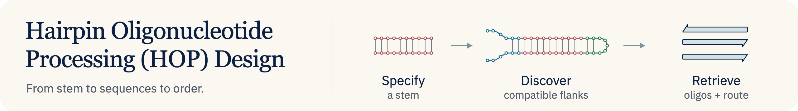

# 

Hairpin Oligonucleotide Processing (HOP) Design finds ways to construct DNA
hairpins and released duplex inserts around a supplied stem. Compare compatible
sequences and enzyme choices, inspect each processing step, and retrieve the
source, adapter and primer sequences with their required end chemistry, such as
a 5′ phosphate.

## Start here

1. [Install HOP](https://github.com/e-south/hop-design/blob/main/docs/guides/install.md).
2. [Discover designs around your stem](https://github.com/e-south/hop-design/blob/main/docs/guides/discover-designs.md): define the
   product, inspect a preparation, and retrieve its oligos.

## Documentation

- [How construction works](https://github.com/e-south/hop-design/blob/main/docs/start/mental-model.md): inputs, construction steps and
  search limits.
- [Task index](https://github.com/e-south/hop-design/blob/main/docs/index.md), [CLI commands](https://github.com/e-south/hop-design/blob/main/docs/reference/cli.md), and
  [Python API](https://github.com/e-south/hop-design/blob/main/docs/reference/python-api.md).
- For sequence anatomy without a preparation route, [compile an exact or DNA
  IUPAC design](https://github.com/e-south/hop-design/blob/main/docs/guides/quickstart.md) or
  [preview a substrate space](https://github.com/e-south/hop-design/blob/main/docs/guides/substrate-spaces.md).

## Contribute

[Report a bug](https://github.com/e-south/hop-design/issues),
[report a vulnerability](https://github.com/e-south/hop-design/blob/main/SECURITY.md), [contribute](https://github.com/e-south/hop-design/blob/main/CONTRIBUTING.md), or
[work with a coding agent](https://github.com/e-south/hop-design/blob/main/AGENTS.md).

## Cite HOP

Please cite HOP Design and record the software version or commit used.
